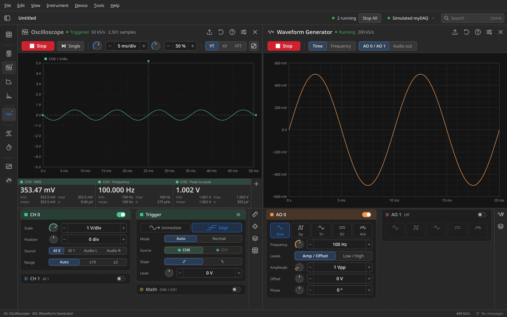

<p align="center">
  <picture>
    <source media="(prefers-color-scheme: dark)" srcset="docs/images/logo-app-dark.svg">
    
  </picture>
</p>

<p align="center">Free bench instruments for the NI myDAQ.</p>



Download and documentation: **[mybench.spunwave.com](https://mybench.spunwave.com)**

Runs on macOS 14 or later, Windows 10 and 11, and Linux.

## Build from source

Needs CMake, Ninja, Qt 6.9 or later (with Qt Shader Tools) and libusb-1.0.

```sh
git clone --recursive https://github.com/spunwave/mybench.git
cmake -S mybench -B mybench/build -G Ninja -DCMAKE_BUILD_TYPE=Release
cmake --build mybench/build
```

The myDAQ USB driver, mybench-ni, is closed and not part of this repository, so a build from source
has the simulated myDAQ only. To talk to a real myDAQ, use the packages from the website, which
include the driver.

Licensed under GPL-3.0-or-later ([LICENSE](LICENSE)), with a linking exception ([LICENSE-EXCEPTION.md](LICENSE-EXCEPTION.md)).
